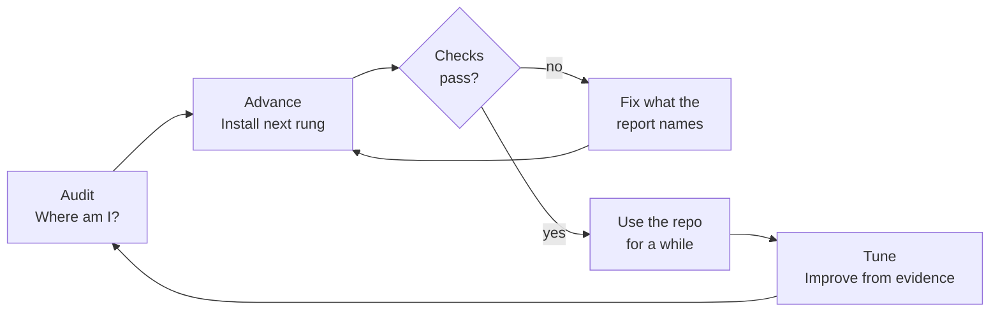
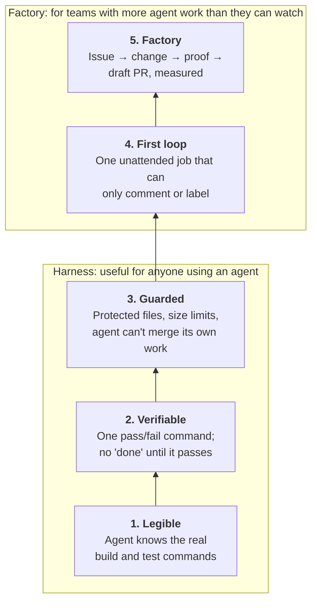
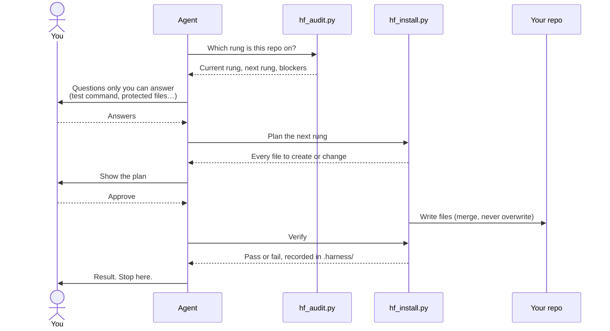

# Harness Factory

**Make a repository ready for AI coding agents, one proven step at a time.**

Harness Factory checks how ready your repository is for coding agents, then sets it up in five steps ("rungs"). Each rung is installed only after the one below it is proven to work. Everything it adds is plain files in your repository that you can read, change, or delete.



## Contents

- [Quick start](#quick-start)
- [Why this exists](#why-this-exists)
- [Do you need this?](#do-you-need-this)
- [The five rungs](#the-five-rungs)
- [How one rung gets installed](#how-one-rung-gets-installed)
- [New project or existing one](#new-project-or-existing-one)
- [What gets installed](#what-gets-installed)
- [What it deliberately does not do](#what-it-deliberately-does-not-do)
- [Supported agents](#supported-agents)
- [Honest limits](#honest-limits)
- [Glossary](#glossary)

## Quick start

Requires `python3` (3.9+) and `git`. `gh` is used for GitHub checks when available. With Claude Code, use v2.1.295 or later: older versions let a tool call continue when a guard hook crashes.

**Claude Code** (as a plugin):

```
/plugin marketplace add thevrus/harness-factory
/plugin install harness-factory@harness-factory
```

**Codex, Cursor, Gemini CLI, Copilot, OpenCode and other agents that load Agent Skills:**

```
npx skills add thevrus/harness-factory
```

Or copy the `skills/harness-factory/` folder into your agent's skills directory by hand. It is self-contained.

Then open your agent inside the repository you want to set up and ask in plain words:

| Say | What happens | Changes files? |
|---|---|---|
| "Audit this repo for agent readiness" | Shows which rung the repo is on and what is missing for the next one | No |
| "Advance the harness one rung" | Installs the next rung, then proves it works | Yes, after you approve the plan |
| "Tune the harness" | Reviews how the harness is doing and proposes improvements | Only what you approve |

In Claude Code you can also type `/harness-factory:harness-factory audit` (or `advance`, `tune`).

Start with the audit. It changes nothing and tells you what to do next.

No agent at hand? The audit is a plain script:

```
python3 skills/harness-factory/scripts/hf_audit.py --repo /path/to/your/repo
```

## Why this exists

A coding agent writes code fast. Whether that code is any good depends less on the agent than on what surrounds it:

- Can it find the real build and test commands, or does it guess?
- When it says "done", is there a command that proves it?
- If it makes a mistake, is the damage limited, or can it edit deploy scripts and push to main?
- If it runs without you watching, who can trigger it, and what stops it from running up a bill?

That surrounding layer of instructions, checks, and guards is the **harness**. A weak harness is why an agent that looked great in a demo produces work you have to redo.

A **software factory** is a harness plus automation: agents that pick up issues, write changes, check them, and open pull requests on their own, while people review the result.

Most guides tell you to install the whole factory at once. That fails, because automation on a weak harness produces changes nobody can trust. Harness Factory builds from the bottom up instead.

## Do you need this?

| You probably **do** if | You probably **don't** if |
|---|---|
| You often correct or redo an agent's work on a real project | You use agents for throwaway scripts, prototypes, or learning |
| The agent says something works and later it doesn't | The project has no tests and you don't plan to write any (start with a few tests first) |
| You want agents to work unattended (review PRs, sort issues, fix small bugs) safely | You only use autocomplete or ask occasional questions |
| Several teammates use agents, each with a different setup | You already have fast tests, CI, protected branches, a short accurate instructions file, and good agent output (run the audit once to confirm) |
| You're starting a new project and want it agent-ready from day one | |

**You can stop partway.** Most of the value is in rungs 1 to 3. Rungs 4 and 5 pay off for teams with a steady flow of issues and add little to a solo project.

## The five rungs

A rung counts only when every required check on it, and on every rung below it, passes.



| Rung | Name | In plain words | Why at this point |
|---|---|---|---|
| 1 | **Legible** | The agent can find its way around and knows the real build and test commands. | An agent that guesses commands wastes time and invents results. |
| 2 | **Verifiable** | One command says pass or fail, and the agent may not finish until it passes. | Without proof, "done" is an opinion. |
| 3 | **Guarded** | Sensitive files are off limits, large changes are flagged, and the agent cannot merge its own work. | Mistakes will happen. This keeps them small and visible. |
| 4 | **First loop** | One automation runs without you: reviewing PRs or sorting new issues. It can comment and label, nothing more. | A loop with no power to change code shows whether the setup holds. |
| 5 | **Factory** | Agents take approved issues, write the change, prove it, and open a draft PR. Results are measured, and repeated mistakes become new checks. | Only safe once everything below is in place. |

**Where to stop:** a beginner can stop at rung 2 and already have an agent that is much harder to fool itself. A team running agents in CI needs rung 3 before anything else.

### Harness vs factory

| | Harness (rungs 1–3) | Factory (rungs 4–5) |
|---|---|---|
| Think of it as | One worker's workstation | The whole plant |
| Covers | A single agent run | Issue to merged change, across many runs |
| Answers | "Will this run produce correct code I can merge?" | "How do agents work without someone driving each step, safely and at a known cost?" |
| Who needs it | Anyone using a coding agent | Teams with more agent work than they can supervise |
| Measured by | Task passes its checks or not | Share automated, cost per change, revert rate |
| Works alone? | Yes, even if you type every prompt | No, a factory is made of harnessed runs |

A good harness delivers most of the benefit. A study of about 36,000 public repositories found fewer than 1 in 100 running any autonomous agent loop, so stopping after rung 3 puts you in the majority.

## How one rung gets installed

Each advance installs exactly one rung. Scripts decide what passes; the agent only gathers facts and shows you the plan.



The audit never runs your code unless you ask. With `--run` it executes your test and start commands to prove they work.

## New project or existing one

Same ladder either way. What differs is where you start and what slows you down.

**Existing codebase**

- The audit shows where you stand. Many mature repositories already pass most of rung 1 and parts of rung 3.
- Nothing is replaced. Your instructions file, agent settings, CI, and PR template are merged into, and you see every change first.
- The usual blocker is rung 2. Slow, flaky, or hard-to-start tests mean the agent can't prove its work. The audit names the specific problem. Fixing it is real work, and it is what makes agents useful on that codebase.
- Old projects carry knowledge nobody wrote down: the module that must not be touched, the script that looks unused but isn't. Rung 1 asks you for exactly that.

**New project**

- Start once the project builds and runs one test. Rungs 1 to 3 take minutes on a small repository.
- Setting up early means every later change goes through the same checks from the start.
- Skip rungs 4 and 5 until there is a steady stream of issues.
- An empty folder is rung 0. Create the project with your usual tools first; Harness Factory doesn't choose your language or framework.

## What gets installed

| File | Added at | Purpose |
|---|---|---|
| `AGENTS.md` | Rung 1 | Short file telling any agent how to build and test, plus what it can't learn from the code |
| `.harness/` | Rung 1+ | Check and guard scripts, their settings, and a log of what was installed |
| Agent wiring (e.g. `.claude/settings.json` hooks) | Rung 2+ | Makes your agent run those scripts at the right moments |
| CI workflow | Rung 3 | Runs the same checks on every pull request |
| Agent workflows | Rung 4+ | Run an agent unattended. **Off** until you set the `AGENT_ENABLED` repository variable |

Existing files are merged into, never silently skipped or overwritten.

**To remove it:** delete `.harness/` and the marked sections it added. `.harness/installed.json` lists every file it wrote.

## What it deliberately does not do

- **No codebase summary for the agent.** Generated overviews cost reading time on every request, and a study found they lowered task success. The instructions file holds only what a person knows and the code doesn't show.
- **No writing your tests.** It tells you when there are none. Tests encode what your software should do; that's your call.
- **No self-grading.** Pass or fail comes from scripts, never from the agent saying so.
- **No switching on automation for you.** You flip the switch, and one setting turns it all off.
- **No changing its own rules unsupervised.** Tune mode proposes changes with evidence; a person approves.

## Supported agents

The checks, guards and CI workflow are plain scripts, so they work whichever agent wrote the change. In-session wiring differs per agent:

| Agent | Reads the instructions | Guard before edits and commands | Check before finishing | Deny rules in the repo |
|---|---|---|---|---|
| Claude Code | Yes | Yes | Yes | Yes |
| Codex | Yes | Yes | Yes | Commands only |
| Cursor | Yes | Yes | Yes | CLI only |
| Gemini CLI | Yes | Yes | Yes | No |
| GitHub Copilot | Yes | Yes | Yes | No |
| OpenCode and other `AGENTS.md` readers | Yes | No, CI only | No, CI only | No |

You pick the agents your repository uses; nothing is installed for the others. The unattended loops at rungs 4 and 5 run on Claude only in this version. Details and caveats: [`docs/agents.md`](docs/agents.md).

## Honest limits

- This is version 0.1. It has been checked for internal consistency, not yet proven across many real repositories.
- The practices come from published engineering write-ups and open-source tools. Many success numbers in that material come from companies selling related products. Treat the ladder as a sensible order of work and judge results on your own repository; the harness records them for that purpose.
- The agent workflows at rungs 4 and 5 have been linted, reviewed and exercised step by step on a local machine, but not yet run end to end on GitHub Actions. Try them on a test repository first.
- Scripts on your machine can be worked around by a determined agent. The guards that hold are server-side: protected branches and required checks. Rung 3 tells you which to turn on.
- A harness doesn't replace understanding your code. If nobody reads what agents write, the gap between what the code does and what anyone understands keeps growing.

## Glossary

| Word | Meaning |
|---|---|
| Agent | An AI tool that reads and changes code and runs commands for you |
| Harness | Everything around the agent that guides and checks it: instructions, checks, guards |
| Factory | A harness plus automation that runs agents without a person driving each step |
| Rung | One step on the ladder |
| Gate | A check that must pass, such as tests or the linter |
| Smoke run | A quick check that the app starts and its main feature works |
| Hook | A script the agent runs automatically at a set moment, such as before editing a file |
| Protected path | A file or folder the agent may not change without a person approving |
| Unattended | Running without a person watching, e.g. in CI |
| Draft pull request | A proposed change marked as not ready to merge |

## More detail

- [`docs/checks.md`](docs/checks.md): every check, why it matters, how it is detected, how to fix it
- [`docs/agents.md`](docs/agents.md): what is wired for each coding agent and what is left to CI
- [`docs/design.md`](docs/design.md): the design decisions and the evidence behind each
- [`skills/harness-factory/SKILL.md`](skills/harness-factory/SKILL.md) and [`references/`](skills/harness-factory/references/): the procedures the agent follows, and what each rung asks of you
- [`evals/`](evals/): behavior tests for the skill itself (for contributors; running them costs model usage)

## License

MIT
